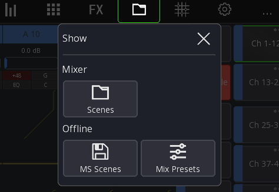
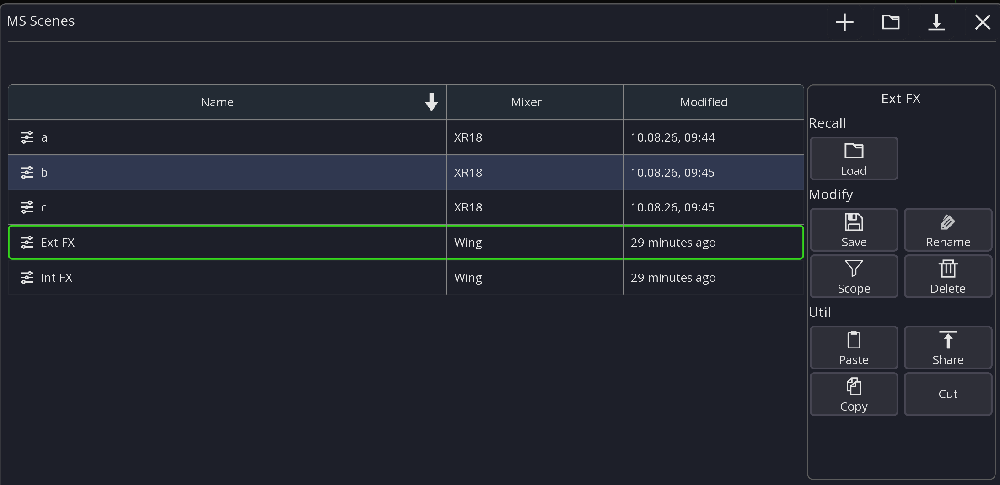
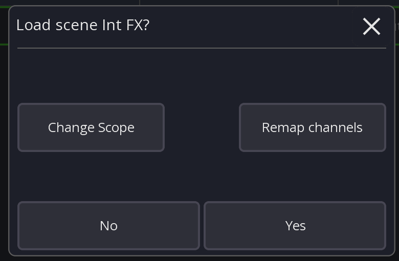
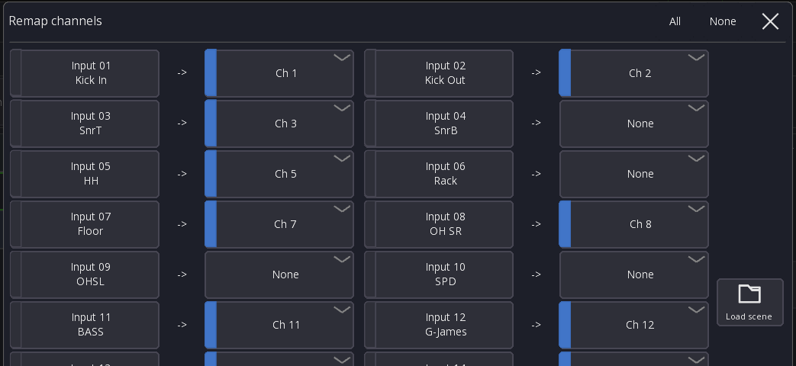
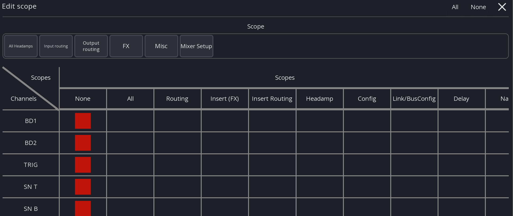
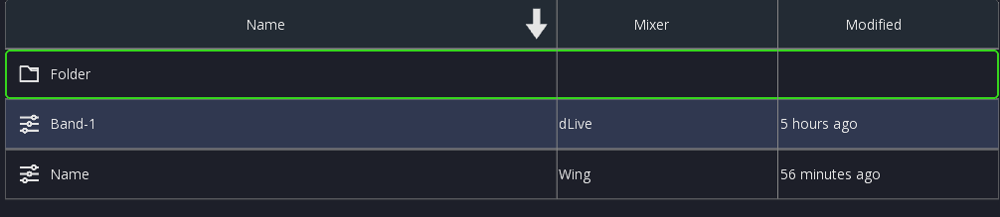
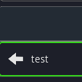

# MS Scenes

MS Scenes store all mixer parameters of the current session on your device.

You can recall MS Scenes on **any** mixer that is supported by Mixing Station.

This allows you to very quickly get your mix ready on another desk, even from another manufacturer!

Each Scene has a recall scope that is stored with the scene. This allows you to build scenes that only recall specific
parameters
for some channels. By default, an MS Scene will always recall everything.

## Usage

MS Scenes can be accessed via the main menu `Show` button:

### Saving

To save a new scene press the `+` button in the top menu.

A MS Scene will always store all the data, regardless of the selected scope.

### Loading

Select the scene you want to load and press the `Load` button:

In this confirmation dialog you can change what data should be recalled.

Changing the scope from this dialog will only change if for this specific
recall. It won't alter the scope stored in the MS scene.

After recalling a scene you may get a list of errors encountered during recall.
This is expected when recalling on a different mixer model where certain functionality is missing.

#### Remap channels

After pressing `Remap channels` you'll see all channels in the scene with a preview
to which channel this data will be applied to:

This is useful if you for example load the scene on a different mixer or
a different channel layout.

You can also map the channel data to `None` so they don't get recalled.

### Scopes

The recall scopes are stored in each MS scene. By default,
everything is recalled.

If you want to permanently change what should be recalled
from a specific scene press the `Scope` button:

In this dialog you can modify which data should be recalled.

The scopes in the top bar are global parameters such as FX.
In the table below you can configure the recall scope for
each channel in the MS scene.

Press and hold a scope name (for example `Delay`) to toggle the scope for all channels.
Similar to the routing matrix you can press and hold a cell to "draw" the scopes as well.

By pressing `Save` the scope configuration is saved in the MS scene.

Here is a table of what each scope contains

| Mixer-Data Scope | Description                               |
|------------------|-------------------------------------------|
| Headamps         | Gain, Phantom, Pad for ALL headamps       |
| Input routing    | Wing: Source configs, X32: Input blocks   |
| Output routing   | Output sockets, Direct outs               |
| FX               | All FX racks                              |
| Misc             | Mutegroups, AMM (Automix)                 |
| Console Setup    | PAFL Settings, global console preferences |

| Channel Scope  | Description                                          |
|----------------|------------------------------------------------------|
| Routing        | Input routing                                        |
| Insert (FX)    | The FX parameters of any inserted FX                 |
| Insert Routing | Insert routing data                                  |
| Headamp        | Gain, Phantom of the headamp assigned to the channel |
| Config         | Phase invert, Trim, DCA/Mutegroup assignment         |
| Link           | Channel link                                         |
| Delay          | Delay on/off and times                               |
| Name           | Name and color                                       |
| Gate           | Gate / first dynamics slot                           |
| EQ             | Preamp filters, PEQ, GEQ                             |
| Dyn            | Compressor / second dynamics slot                    |
| Sends          | Send levels, on/off and tap points                   |
| Main           | Fader, Mute, Pan                                     |

## File handling

Press the `Folder` menu item to create a new folder:

To leave the folder double tap on it again:

### Moving scenes

1. Select the scene you want to move
2. Select `Cut`
3. Open the folder you want to move the scene to
4. Select `Paste`