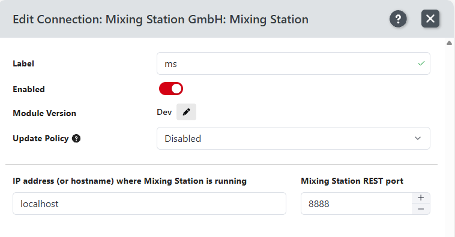
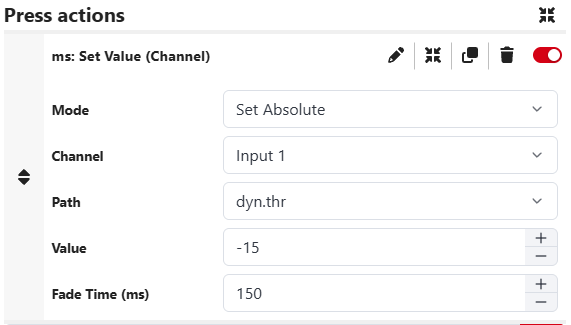

# Companion Module

Mixing Station has a [companion module](https://github.com/bitfocus/companion-module-devcore-mixingstation)
that allows you to access all mixer parameters directly within Companion.

## Setup

1) Enable the Rest API in Mixing Station (see [api](apis.md) for details)
2) Install the "Mixing Station" companion module
3) Enter the Port you're set in step 1: 
   
   

## Usage

The actions available are described in the help for the module, see
https://github.com/bitfocus/companion-module-devcore-mixingstation/blob/master/companion/HELP.md

Example action:

